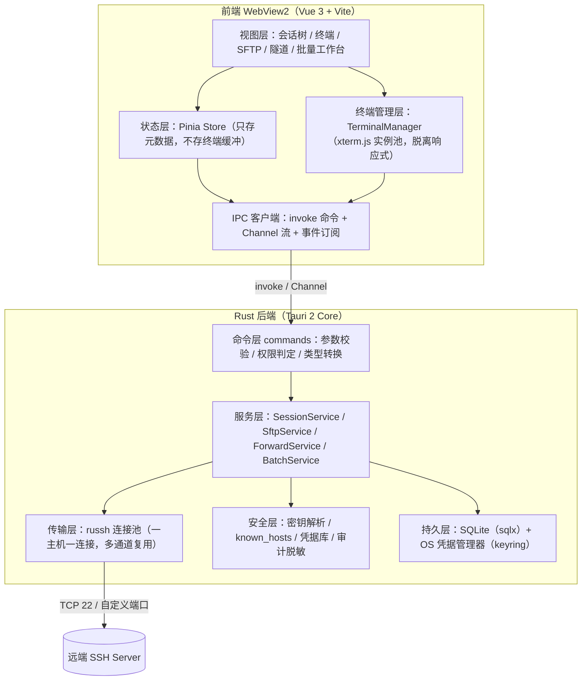
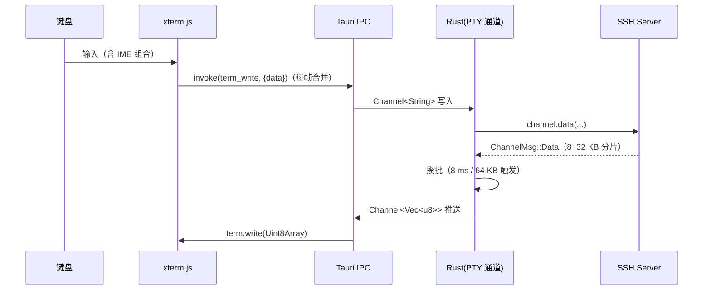

# MangoShell 自研 SSH 客户端技术方案

> 版本：v0.1（方案稿）
> 技术栈：Tauri 2.x（Rust）+ Vite + Vue 3 + TypeScript
> 功能范围：SSH 终端、会话/密钥管理、SFTP 文件管理、端口转发/隧道、批量运维

---

## 1. 目标与范围

### 1.1 产品目标

做一个**本地原生体验**的 SSH 客户端：安装包小（目标 < 15 MB）、启动快（冷启动 < 1.5 s）、终端输入延迟低（本地回显 P95 < 30 ms）、多会话/多标签稳定不卡、凭据不出本机。

### 1.2 本期范围

| 能力 | 说明 | 优先级 |
|---|---|---|
| SSH 终端 | 多标签、多窗口、断线重连、搜索、日志录制 | P0 |
| 会话/密钥管理 | 分组树、密码/密钥/Agent 认证、known_hosts 校验、导入 `~/.ssh/config` | P0 |
| SFTP | 双栏浏览、上传下载、断点续传、改权限、拖拽 | P1 |
| 端口转发 | 本地 `-L`、远程 `-R`、动态 SOCKS5 `-D`，可视化隧道管理 | P1 |
| 批量运维 | 多主机并发执行、命令片段库、结果汇总导出 | P2 |

### 1.3 非目标（本期不做，但架构留口）

- 本地 Shell / 串口终端（可由同一套终端渲染层 + `portable-pty` 扩展，接口已抽象好）
- 团队级堡垒机 / 会话审计中心 / 云端同步（需要服务端）
- 移动端

---

## 2. 总体架构

### 2.1 分层



### 2.2 线程与运行时模型

- **单一 Tokio 多线程运行时**（`#[tokio::main]` 或 Tauri 的 async runtime 内），SSH I/O 全异步，**不阻塞 WebView 线程**。
- 一个远程主机 = **一条 TCP 连接 + 一个 `russh::client::Handle`**，其上的终端、SFTP、转发全部以 **Channel 复用** 这条连接（关键性能设计，见 5.1）。
- 阻塞型工作（SQLite 若用 rusqlite、大文件哈希）走 `spawn_blocking`。
- 后端对前端只暴露两种流：**命令返回值**（短、JSON）和 **Channel 流**（长、二进制）。

### 2.3 关键数据流（终端）



**方向性要点**：上行（键盘）量小可走普通命令；下行（输出）量大必须走 Channel + 攒批，绝不用 `emit` 事件逐包广播。

---

## 3. 技术选型

### 3.1 SSH 协议实现（最关键的决策）

| 方案 | 优点 | 缺点 | 结论 |
|---|---|---|---|
| **russh**（纯 Rust，基于 tokio） | 无 C 依赖、Windows 交叉编译零痛苦、异步原生、支持 direct-tcpip / tcpip-forward / 多通道 | 部分老算法（`ssh-rsa`、`diffie-hellman-group1-sha1`）需显式开启；API 版本间有变动 | **主选** |
| ssh2（libssh2 绑定） | 成熟、算法覆盖广 | 依赖 OpenSSL/vcpkg，Windows 构建产物体积与链路复杂；同步 API 需包 `spawn_blocking` | 备选 |
| 调用系统 `ssh.exe` | 兼容性天花板、零协议开发 | 无法做 SFTP 文件树/隧道可视化、无法精细控制与审计 | **降级兜底**（仅用于极老服务器或 `-R` 异常场景） |

配套：
- **SFTP**：`russh-sftp`（协议层）或 `openssh-sftp-client`（高层封装，自带并行读写与进度回调，推荐直接用后者）。
- **密钥解析**：`ssh-key`（RustCrypto），支持 OpenSSH 私钥、PEM/PKCS#8、加密私钥（bcrypt_pbkdf + AES-GCM / ChaCha20）。
- **算法兼容性**：在 `russh::client::Config.preferred` 中按"安全优先 + 兼容开关"两套 profile，用户级设置 `legacy_algorithms: bool`。

### 3.2 前端

| 关注点 | 选型 | 理由 |
|---|---|---|
| 框架 | Vue 3.5（`<script setup>` + TS）+ **Vite+**（`vp` CLI，内含 Vite + Rolldown） | 你指定；dev/build/check/test 收敛成一套命令，lint/format 走 Oxc 极快，详见 3.5 |
| 状态 | Pinia（只放会话树、标签、设置等轻量元数据） | 终端缓冲绝不能进响应式，避免 Proxy 拖慢 |
| 终端 | `@xterm/xterm` + `addon-fit` / `addon-webgl` / `addon-search` / `addon-web-links` / `addon-serialize` / `addon-unicode11` / `addon-clipboard` | 事实标准；WebGL 渲染在大输出量下比 DOM 快 3~10 倍 |
| UI 库 | **shadcn-vue**（源码复制式组件，底层 reka-ui + Tailwind） | 组件进仓库可任意改，无第三方主题锁；无运行时"组件库"体积负担，只打包用到的；适合做密排的桌面工具界面。代价：没有现成的 Tree / 虚拟列表，需自研或拼装 |
| IPC 类型 | `tauri-specta` 生成 TS 类型与调用桩 | Rust 命令与前端类型不会漂移 |
| 测试 | Vitest（前端纯逻辑）+ Tauri 官方 `tauri-driver` + msedgedriver（E2E） | 关键路径可回归 |

### 3.3 其他

- **持久化**：SQLite（`sqlx` + 编译期校验 SQL），库文件放 `app_data_dir`；开启 WAL。
- **凭据**：`keyring` → Windows Credential Manager / macOS Keychain / Linux Secret Service；可选"便携模式"用主密码派生密钥（Argon2id + XChaCha20-Poly1305）加密本地 vault。
- **日志**：`tracing` + `tauri-plugin-log`，默认 INFO，敏感字段（密码、私钥、token）白名单式脱敏。
- **更新**：`tauri-plugin-updater`（需签名密钥）+ `tauri-plugin-dialog`。

### 3.4 UI 层：shadcn-vue 落地设计

#### 3.4.1 技术组成

shadcn-vue 不是 npm 运行时依赖，而是 **CLI 把组件源码复制进 `src/components/ui/`**，因此：

- 组件即我们的代码 → 可以直接改密度、圆角、边框、行高，不受第三方版本约束；
- 底层无障碍/交互原语由 **reka-ui**（原 radix-vue）提供，焦点管理、键盘导航、浮层定位都是工业级；
- 样式由 **Tailwind CSS v4** 驱动（`@tailwindcss/vite` 插件 + `@theme inline` CSS 变量），不再需要 `tailwind.config.js`；**SCSS 作为补充层**只承担 Tailwind 表达不好的部分（见 3.4.6）；
- 图标统一 `lucide-vue-next`，动画用 `tw-animate-css`（替代 v3 时代的 `tailwindcss-animate`）。

#### 3.4.2 初始化

```bash
# 1) Tailwind v4 + SCSS + 基础工具
pnpm add -D tailwindcss @tailwindcss/vite sass-embedded
pnpm add class-variance-authority clsx tailwind-merge tw-animate-css reka-ui lucide-vue-next

# 2) 初始化 shadcn-vue（生成 components.json 与 CSS 变量）
npx shadcn-vue@latest init

# 3) 按需拉取本项目要用的组件
npx shadcn-vue@latest add button input label form table dialog sheet alert-dialog \
  tabs tooltip dropdown-menu context-menu command resizable scroll-area switch \
  select progress badge separator sonner
```

`vite.config.ts` 必须同时配 alias（否则组件里的 `@/lib/utils` 解析失败）：

```ts
// vite.config.ts
import path from 'node:path'
import { defineConfig } from 'vite'
import vue from '@vitejs/plugin-vue'
import tailwindcss from '@tailwindcss/vite'

export default defineConfig({
  plugins: [vue(), tailwindcss()],
  resolve: { alias: { '@': path.resolve(__dirname, './src') } },
  // SCSS：每个 .scss 自动注入变量与 mixin，免去重复 @use（见 3.4.6）
  css: {
    preprocessorOptions: {
      scss: {
        api: 'modern-compiler',
        additionalData: `@use "@/styles/abstracts" as *;`,
      },
    },
  },
  // Tauri 约定：固定端口 + 忽略 Rust 源码变更，避免热更新抖动
  clearScreen: false,
  server: { port: 1420, strictPort: true, watch: { ignored: ['**/src-tauri/**'] } },
})
```

`tsconfig.json` 同步加 `"paths": { "@/*": ["./src/*"] }`，`components.json` 里 `aliases.ui` 指向 `@/components/ui`。

主题变量入口（Tailwind v4，无 config 文件）：

```css
/* src/assets/styles/index.css */
@import "tailwindcss";
@import "tw-animate-css";
@custom-variant dark (&:is(.dark *));

@theme inline {
  --color-background: var(--background);
  --color-foreground: var(--foreground);
  --color-primary: var(--primary);
  --color-border: var(--border);
  --radius-md: calc(var(--radius) - 2px);
}

:root {
  --radius: 6px;                    /* 桌面端收敛圆角 */
  --background: #ffffff;
  --foreground: #0f1115;
  --primary: #2563eb;
  --border: #e6e8ec;
}

.dark {
  --background: #14161a;
  --foreground: #e6e8ec;
  --primary: #4f8cff;
  --border: #2a2e37;
}
```

#### 3.4.3 功能 → 组件映射

| 功能 | 采用方案 |
|---|---|
| 会话树（分组 + 主机） | 自研 `HostTree.vue`（reka-ui 的 Collapse 原语）+ `@tanstack/vue-virtual` 虚拟滚动 + `ContextMenu`（右键：连接/编辑/复制/删除） |
| 多标签栏 | 自研 tab bar（需中键关闭、拖拽排序、溢出滚动），不用现成 `Tabs`——它的语义是面板切换，不是可关闭文档 |
| 终端分屏 | `Resizable`（基于 reka-ui Splitter，支持水平/垂直嵌套） |
| SFTP 双栏 | `Resizable` + `Table` + `DropdownMenu`（右键菜单）+ `Progress` + `Sonner` |
| 新建/编辑会话 | `Sheet`（侧边抽屉式，比 Dialog 更适合多字段表单）+ `Form`（vee-validate + zod 校验） |
| 密钥导入向导 | `Dialog` + `Stepper`（自研）+ `Input`（密码框显隐） |
| 转发管理 | `Table` + `Badge`（running/error 状态色）+ `Switch`（autoStart） |
| 批量运维工作台 | TanStack Table（`@tanstack/vue-table`）+ 行级 `Badge` + 底部 `Progress` + `AlertDialog` 危险确认 |
| 快速连接 | `Command`（`Ctrl/Cmd + K`）：搜主机、切标签、跑片段 |
| 全局通知 | `Sonner`（右上角，区分 success/error，连接断开用持久 toast） |
| 设置页 | `Tabs` + `Form` + `Switch`/`Select`/`Slider` |

> 注意：shadcn-vue **没有 Tree 组件**，会话树是唯一需要认真自研的 UI 部件（约 300~400 行，含拖拽排序时再加 200 行）。

#### 3.4.4 桌面端适配（必须做，否则"网页感"很重）

1. **基准字号 13px、行高更紧**：改 `:root` 的 `--font-size-base`，组件内统一用 `text-[13px]` 而非 `text-sm`（14px 是 Web 尺寸）。
2. **圆角收敛**：`--radius: 6px`（默认 10px 偏软），按钮/输入框统一 `rounded-md`。
3. **去除多余动效**：桌面工具不需要 hover 抬升、按钮缩放；只保留浮层进入/退出与 toast。
4. **禁用网页默认行为**：全局 `user-select: none` + 自定义右键菜单，但**终端区、SFTP 文件列表、日志区必须保留选中与复制**（限定 `user-select: text`）。
5. **焦点环**：用 `:focus-visible` 而非 `:focus`，避免鼠标点击出现一圈高亮。
6. **暗色跟随系统**：`@vueuse/core` 的 `useColorMode` + Tauri `getCurrentWindow().onThemeChanged()`，保证系统切主题时应用同步，不留白闪。
7. **字体本地内置**：把终端等宽字体（JetBrains Mono / Cascadia Code）打进资源包，禁止 `@import` 远程字体——离线环境会回退到系统字体导致终端列宽错位。
8. **滚动条**：统一走 `ScrollArea` 或自定义 `::-webkit-scrollbar`（WebView2 支持，macOS WKWebView 需 `scrollbar-width` 兜底）。

#### 3.4.5 Tauri 环境特有坑

| 坑 | 表现 | 处理 |
|---|---|---|
| Tailwind v4 使用 `oklch()` / `color-mix()` | Linux WebKitGTK 老版本不识别，颜色整体丢失或发灰 | 在 `@theme inline` 里提供 rgb 变量兜底，或设置 `@supports` 降级；发版前在 Ubuntu 22.04 上实测 |
| `backdrop-filter` 模糊 | Windows WebView2 正常，macOS/Linux 表现不一 | 浮层不用毛玻璃，改用纯色 + 阴影 |
| 浮层被裁切 | 终端容器 `overflow: hidden` 导致 Dropdown 被裁 | reka-ui 的 `Teleport` 默认已处理；自定义浮层务必走 `Portal` |
| HMR 下组件状态丢失 | 改样式后终端实例被重建 | 终端实例在 `TerminalManager` 中按 `tabId` 持有，与组件生命周期解耦（见附录 B.2） |
| Tailwind 扫描不到动态类名 | 状态色如 `bg-${color}-500` 不生成 | 用 `cva` 显式枚举变体，禁止字符串拼接类名 |

#### 3.4.6 SCSS 接入与边界（重要）

**前提**：Tailwind v4 官方明确不推荐混用预处理器，因为 v4 依赖 `@theme`、`@property`、`color-mix()` 这类必须被 Tailwind 引擎直接看到的语法。所以边界只有一条：

> **Tailwind 入口永远是纯 `.css`；SCSS 只写 Tailwind 之后的项目样式，不参与 Tailwind 的 token 生成。**

##### 分工

| 用 Tailwind 写 | 用 SCSS 写 |
|---|---|
| 组件布局、间距、颜色、状态变体 | 需要多层嵌套的第三方 DOM 覆盖（xterm、文件树） |
| shadcn-vue 组件内部样式 | 复用型 mixin（滚动条、文本省略、格子线） |
| 响应式与暗色（`dark:`） | `@keyframes`、复杂伪元素序列 |
| 图标尺寸、圆角 | 构建期常量（z-index 层级、终端字体栈） |

##### 目录

```
src/styles/
├─ index.css                  # Tailwind 唯一入口：@import "tailwindcss"; @theme inline; :root/.dark 变量
├─ abstracts/
│  ├─ _index.scss             # @forward "variables"; @forward "mixins";
│  ├─ _variables.scss         # z-index、字体栈、固定间距（不随主题变化）
│  └─ _mixins.scss            # scrollbar()、ellipsis()、term-grid()
└─ components/                # 全局样式：xterm DOM 覆盖、Teleport 浮层修正
```

```scss
// src/styles/abstracts/_variables.scss
$z-terminal: 10;
$z-overlay: 1000;
$term-font-stack: "JetBrains Mono", "Cascadia Code", ui-monospace, monospace;

// src/styles/abstracts/_mixins.scss
@mixin scrollbar($size: 8px) {
  &::-webkit-scrollbar { width: $size; height: $size; }
  &::-webkit-scrollbar-thumb { background: var(--border); border-radius: $size; }
  &::-webkit-scrollbar-track { background: transparent; }
}

// src/styles/abstracts/_index.scss
@forward "variables";
@forward "mixins";
```

##### 七条硬规则

1. **`@import "tailwindcss"` 绝不写进 `.scss`** —— Sass 会把它当作 Sass 文件导入并报 `Can't find stylesheet to import`。入口保持 `index.css`。
2. **`<style lang="scss">` 里不用 `@apply`** —— Vite 下 Tailwind 插件与 Sass 的处理顺序不稳定，`@apply` 在 scss 块中常出现"未知工具类"。要复用就写 `@layer components` 的普通类，或直接在模板上用工具类。
3. **Sass 一律 `@use` / `@forward`，禁用 `@import`** —— Dart Sass 1.80 起 `@import` 已弃用，计划 3.0 移除。`additionalData` 注入的也必须是 `@use`。
4. **`additionalData` 只能放 `@use`/变量声明**，不能放规则 —— 它会被拼到每个 scss 文件头部，放 CSS 规则会重复输出 N 份、产物膨胀。
5. **主题切换只能靠 CSS 变量** —— Sass 变量是构建期静态求值，切 `.dark` 不会变；只有"不随主题变化"的量（z-index、字体栈）才进 Sass 变量。
6. **新增设计 token 改 `index.css` 的 `@theme inline`**，不要在 SCSS 里另起一套颜色体系，否则 shadcn 组件读不到。
7. **覆盖 xterm 内部 DOM 必须 `:deep()`**，且优先放全局 `styles/components/`：

```vue
<style lang="scss" scoped>
.term-wrap {
  :deep(.xterm-viewport) { @include scrollbar(10px); }
  :deep(.xterm-rows) { letter-spacing: 0.2px; }
}
</style>
```

##### 常见坑

| 坑 | 现象 | 处理 |
|---|---|---|
| Tailwind 入口写成 `.scss` | Sass 解析 `@import "tailwindcss"` 直接失败 | 入口固定 `.css` |
| `additionalData` 用相对路径 | 注入到不同目录的文件时路径错位 | 用别名 `@/styles/abstracts`；若某版本不解析别名，改为在每个文件手写 `@use` |
| 装 `sass` 而非 `sass-embedded` | 大项目冷启动明显变慢 | 装 `sass-embedded`，Vite 会优先使用 |
| 在 SCSS 里用 `@theme` | 无效，变量不生成 | `@theme` 只写在 `index.css` |
| 混用两套颜色变量 | 暗色切换后部分区域不变 | 统一消费 `var(--xxx)` CSS 变量 |

> shadcn-vue 深度绑定 Tailwind，因此**不建议为了 SCSS 而放弃 Tailwind** —— 那等于把所有 `ui/` 组件重写一遍。若团队规范要求"样式必须写在 SCSS 里"，正确做法是只把**业务层**样式（页面级、复杂组件级）用 SCSS 组织，原子组件仍保持工具类。

### 3.5 工具链：Vite+（`vp`）

#### 3.5.1 它是什么

[Vite+](https://viteplus.dev/) 1.0 是 VoidZero 出的**统一工具链**（MIT），一个 `vp` 命令接管七件事：

| 能力 | 底层 | 对应我们原来的方案 |
|---|---|---|
| 运行时版本 | 自动选 Node（`vp env`） | 手动 `nvm use` / `.nvmrc` |
| 包管理器 | 按项目自动识别 pnpm/npm/yarn/bun | 靠约定 |
| dev / build | Vite + **Rolldown** | `vite` + `vite build` |
| check | **Oxlint + Oxfmt + tsgo** | eslint + prettier + vue-tsc 三条流水线 |
| test | Vitest | `vitest` |
| run | Vite Task（依赖感知 + 缓存） | pnpm workspace 手写编排 |
| pack | Rolldown / tsdown | 本期不需要 |

对我们的实际收益是 **CI 从三条命令降到一条**，以及 lint/format 快一个量级（官方口径：lint 比 ESLint 快约 50~100×）。

#### 3.5.2 命令映射

```powershell
# Windows 安装（macOS/Linux: curl -fsSL https://vite.plus | bash）
irm https://vite.plus/ps1 | iex
```

| 原来 | 改成 |
|---|---|
| `pnpm dev` | `vp dev` |
| `pnpm build` | `vp build` |
| `eslint . && prettier -c . && vue-tsc --noEmit` | `vp check`（`--fix` 自动修） |
| `vitest run` | `vp test` |
| `pnpm tauri dev` | `vp run tauri dev` |

#### 3.5.3 与 Tauri 的集成点

- `src-tauri/tauri.conf.json` 里改两处即可，**Tauri 不关心前端命令是谁跑的**：
  ```json
  { "build": {
      "beforeDevCommand": "vp dev",
      "beforeBuildCommand": "vp build",
      "devUrl": "http://localhost:1420",
      "frontendDist": "../dist"
  } }
  ```
- `vite.config.ts` 仍是唯一配置源（端口 1420、`strictPort`、忽略 `src-tauri/**`），Vite+ 复用同一份配置，**不要把配置迁到 `vp` 私有文件里**。
- Rust 工具链（rustup / cargo）不在 Vite+ 管辖内，CI 仍需单独装。
- CI 用官方 [`voidzero-dev/setup-vp`](https://github.com/voidzero-dev/setup-vp) 固定 vp 与 Node 版本，保证可复现。
- 包管理命令（`pnpm add`）可照常使用，vp 会自动识别；也可改用 `vp install`。

#### 3.5.4 M0 必须验证的三点（别直接全量切换）

1. **`vp check` 对 `.vue` SFC 的覆盖度**：Oxlint 的 Vue 规则集不如 `eslint-plugin-vue` 全（template 表达式、自定义指令相关规则尤其容易缺）。若差距明显，只保留 `eslint-plugin-vue` 跑 Vue 专项规则，其余交给 `vp check`——**不要两条流水线全跑**，否则 CI 时间白涨。
2. **`vp dev` 的端口与参数透传**：Tauri 会等 `devUrl` 就绪才启动窗口，需确认 `vp dev` 不额外改写端口、在 `strictPort` 下失败时能明确报错。
3. **Rolldown 构建差异**：`vp build` 底层是 Rolldown 而非 Rollup，个别依赖 Rollup 内部钩子的插件可能行为不同。xterm / shadcn-vue / Tailwind 这类纯 ESM + CSS 生态基本无感，但 M0 要打一次生产包实测。

> 另外，shadcn-vue 复制进来的组件初次会被 `vp check --fix` 改格式，产生一次大 diff。**建议在第一次 `add` 之后立刻跑一次 fix 并单独提交**，避免后续 PR 里混入纯格式变更。

---

## 4. 工程结构

```
MangoShell/
├─ src/                          # 前端
│  ├─ main.ts
│  ├─ App.vue
│  ├─ core/
│  │  ├─ ipc/                    # invoke 封装、Channel 管理、错误归一化
│  │  ├─ term/                   # TerminalManager、xterm 主题、键位映射
│  │  └─ types/                  # tauri-specta 生成的 bindings.ts
│  ├─ stores/                    # session / tabs / settings / forward / batch
│  ├─ views/
│  │  ├─ TerminalView.vue
│  │  ├─ SftpView.vue
│  │  ├─ ForwardView.vue
│  │  └─ BatchView.vue
│  ├─ components/
│  │  ├─ ui/                    # shadcn-vue 复制进来的原子组件（可自由改，勿手写同义组件）
│  │  ├─ host/                  # HostTree、HostForm（Sheet）、QuickConnect（Command）
│  │  ├─ term/                  # TerminalPane、TabBar、SplitContainer
│  │  ├─ sftp/                  # DualPane、FileTable、TransferQueue
│  │  └─ common/                # RiskConfirm(AlertDialog)、EmptyState
│  ├─ lib/utils.ts              # cn()，shadcn-vue 约定路径
│  └─ styles/
│     ├─ index.css              # Tailwind v4 唯一入口：@theme inline + 亮/暗变量
│     ├─ abstracts/             # _index.scss / _variables.scss / _mixins.scss（自动注入）
│     └─ components/            # 全局样式：xterm DOM 覆盖、Teleport 浮层修正
├─ components.json               # shadcn-vue 配置（aliases、样式基色）
├─ src-tauri/
│  ├─ Cargo.toml
│  ├─ tauri.conf.json
│  ├─ capabilities/default.json  # Tauri 2 权限白名单
│  ├─ migrations/                # SQL 迁移脚本
│  └─ src/
│     ├─ main.rs / lib.rs
│     ├─ commands/               # 薄命令层（只做校验与编排）
│     ├─ session/                # 连接池、认证、keepalive、重连
│     ├─ terminal/               # 终端通道桥、攒批、录制
│     ├─ sftp/
│     ├─ forward/                # L / R / D
│     ├─ batch/
│     ├─ security/               # keyring、vault、known_hosts、host_key 校验
│     └─ store/                  # sqlx 仓储
└─ docs/
```

---

## 5. 核心模块设计

### 5.1 连接与会话管理

**核心抽象**：`HostConnection`（一主机一连接）持有 `russh::client::Handle`，通过 `Arc<RwLock<...>>` 共享；`SessionManager` 用 `HashMap<HostKey, Weak<HostConnection>>` 做池化。

```rust
// src-tauri/src/session/pool.rs
pub struct HostConnection {
    pub host_key: HostKey,          // user@host:port，唯一键
    pub handle: Handle,             // russh 客户端句柄，可克隆
    pub channels: AtomicUsize,      // 当前打开的通道数，用于判定"最后一条通道关闭后是否断开"
    pub last_active: AtomicU64,
}

impl SessionManager {
    /// 取连接：命中则复用；未命中则建连（含跳板机链路）
    pub async fn acquire(&self, host_id: &str) -> Result<Arc<HostConnection>> { /* ... */ }
}
```

关键点：

1. **连接复用**：终端、SFTP、同主机的 `-L` 转发共用一个连接，避免多连接触发服务器 `MaxSessions` 限制。
2. **跳板机（ProxyJump）**：用 `channel_open_direct_tcpip(target_host, 22, ...)` 拿到一条到下一跳的 TCP 流，再用 `russh::client::connect_stream(stream, handler)` 在其上跑 SSH。链路是**递归的**，天然支持多级跳板。
3. **保活**：`keepalive_interval = 30s`，连续 3 次无响应判定掉线；`keepalive_max = 3`。
4. **重连策略**：指数退避 1s→2s→4s→8s，最多 5 次；**重连成功后不自动重放命令**（避免破坏性操作重复执行），仅恢复通道并提示"连接已恢复，工作目录可能已重置"。
5. **断线态**：连接线程销毁后，`SessionManager` 只保留**会话元数据**（主机、标签标题、scrollback 序列化片段），允许用户"一键重连"。

### 5.2 终端数据通道（性能命脉）

**三件事：攒批、背压、二进制。**

```rust
// src-tauri/src/terminal/bridge.rs
#[tauri::command]
pub async fn term_open(
    app: AppHandle,
    state: State<'_, AppState>,
    tab_id: String,
    host_id: String,
    cols: u16,
    rows: u16,
    on_data: Channel<Vec<u8>>,       // 下行：服务器 → xterm
) -> Result<(), String> {
    let conn = state.sessions.acquire(&host_id).await?;
    let mut ch = conn.handle.channel_open_session().await?;
    ch.request_pty("xterm-256color", None, Some((cols, rows, 0, 0))).await?;
    ch.request_shell(true).await?;

    let mut batch: Vec<u8> = Vec::with_capacity(64 * 1024);
    let mut tick = tokio::time::interval(Duration::from_millis(8)); // 攒批周期

    loop {
        tokio::select! {
            msg = ch.wait() => match msg {
                Some(ChannelMsg::Data { data }) => {
                    batch.extend_from_slice(&data);
                    if batch.len() >= 64 * 1024 { on_data.send(std::mem::take(&mut batch))?; }
                }
                Some(ChannelMsg::ExtendedData { data, .. }) => {
                    batch.extend_from_slice(&data);
                }
                Some(ChannelMsg::ExitStatus { .. }) | None => break,
                _ => {}
            },
            _ = tick.tick() => {
                if !batch.is_empty() { on_data.send(std::mem::take(&mut batch))?; }
            }
            else => break,
        }
    }
    Ok(())
}
```

| 优化点 | 做法 | 效果 |
|---|---|---|
| 攒批 | 8 ms 或 64 KB 触发一次 IPC | 把 `cat 大文件` 场景的 IPC 次数从数万降到数十 |
| 编码 | 若 `Channel<Vec<u8>>` 走 JSON 数组（体积约 3.4×），改 `Channel<String>` + base64（1.33×）或走本地 WebSocket 二进制 | 减少 60%+ 流量 |
| 渲染 | WebGL addon，检测 `webglcontextlost` 自动降级 DOM 渲染 | 大输出不卡死 |
| 背压 | 前端每 256 KB 回一个 ack，后端未收到 ack 则暂停 `ch.wait()` 消费（SSH 窗口自然反压） | 防止内存暴涨 |
| 上行 | 键盘输入 16 ms 合并一次（`write` 队列），单次 invoke | 输入不抖动 |

> **务必在 M1 阶段做一次基准**：`seq 1 3000000`（约 25 MB 输出）与 `vttest` 全屏刷新，记录端到端耗时与内存峰值。若 `Channel` 吞吐不足（经验阈值：> 8 MB/s 待验证），切本地 WebSocket 兜底方案（127.0.0.1 + 随机 token + custom protocol 校验）。

**其他终端能力**：
- `resize`：xterm `onResize` → `channel.window_change(cols, rows)`（需节流 100 ms）。
- 搜索：`@xterm/addon-search`，仅搜 scrollback，不请求服务器。
- 录制：在 bridge 层旁路把原始字节写成 **asciicast v2**（`{"version":2}`，只追加 `o` 事件），零额外开销。
- 粘贴保护：多行粘贴弹出确认；识别 `bracketed paste`。
- 字符集/字体：设置项持久化；Windows 下注意高分屏 `devicePixelRatio` 变化重设字号。

### 5.3 认证与密钥管理

支持四种认证，按顺序尝试（与 OpenSSH 行为一致）：

1. **密码** — 仅保存在 keyring，前端只拿到 `has_saved_password: bool`。
2. **公/私钥** — 私钥文件解析与签名**全在 Rust**；前端只看到公钥指纹（`SHA256:xxx`）。
3. **SSH Agent** — Windows 用 named pipe `\\.\pipe\openssh-ssh-agent`，Linux/macOS 用 `SSH_AUTH_SOCK`。
4. **键盘交互（keyboard-interactive）** — OTP/2FA，后端回调前端弹输入框。

**known_hosts 校验（安全底线，不可省略）**：

- 首次连接：TOFU（Trust On First Use）弹窗展示指纹（SHA256 + MD5），用户确认后写入本地 `known_hosts` 表。
- 后续：比对主机密钥；**不匹配则拒绝连接**，只有用户手动"删除该主机密钥"后才能继续，且记录审计日志。
- 支持解析 OpenSSH 的 hashed 格式（`|1|salt|hash`，HMAC-SHA1）与 `[host]:port` 形式，便于导入已有 `known_hosts`。
- 密钥协商阶段必须校验：`russh` 的 `client::Handler::check_server_key` 返回 `Ok(true)` 前完成上述比对。

**存储分层**：

```
SQLite（可导出/可同步的元数据）          OS Keyring（机密）
├─ keys(指纹、类型、备注、公钥)     ←──┤ key_id 引用 → 私钥 / 口令
├─ hosts(...auth_type, key_id)     ←──┤ host_id 引用 → 密码
└─ known_hosts(host, port, blob)       └─ vault 主密钥（便携模式）
```

- 私钥**永不写入 SQLite**，也不通过 IPC 传输给前端。
- 便携模式：用户设主密码 → `Argon2id(m=64MB,t=3,p=4)` 派生 → `XChaCha20-Poly1305` 加密 `secrets.json`（`app_data_dir`，权限 0600），内存中用 `zeroize` 擦除明文。

### 5.4 SFTP 文件管理

```rust
// 每个 SFTP 面板持有一条独立 subsystem 通道
let ch = conn.handle.channel_open_session().await?;
ch.request_subsystem(true, "sftp").await?;
let sftp = SftpSession::new(ch.into_stream()).await?;
```

设计要点：

| 问题 | 方案 |
|---|---|
| 大目录卡 UI | `read_dir` 分页拉取（先 500 条），前端虚拟滚动；排序/过滤在前端做 |
| 大文件慢 | 分块并发（默认 4 并发 × 1 MB），`openssh-sftp-client` 自带并行读写；进度事件用 `Channel<Progress>` 节流 100 ms |
| 断点续传 | 本地记录 `(remote_path, size, mtime, offset)`；mtime 不一致则重传；远端用 `setstat` 设置 mtime/权限 |
| 权限/属性 | 展示 `rwxr-xr-x` + 数字两种；`chmod` 用八进制输入 |
| 符号链接 | 明确区分"跟随"与"作为链接操作"，删除时默认只删链接 |
| 路径安全 | 拒绝含 `..` 的拼接逃逸；Windows 本地路径用 `PathBuf` 归一化，禁用保留名（`CON`/`NUL`） |
| 传输队列 | 全局任务队列（并发上限可配），支持暂停/取消/重试，与 UI 解耦 |

### 5.5 端口转发 / 隧道

| 类型 | 实现方式（russh） | 说明 |
|---|---|---|
| **本地 `-L`** | `channel_open_direct_tcpip(dst_host, dst_port, origin, 0)` + `copy_bidirectional` | 在 `127.0.0.1:port` 起 `TcpListener`，每个入站连接开一条 direct-tcpip 通道 |
| **动态 `-D`** | 本地起 SOCKS5 服务（`fast-socks5`）→ 自定义 connector 走 `direct_tcpip` | 纯本地代码 + 已有 SSH 通道，最稳 |
| **远程 `-R`** | 全局请求 `tcpip_forward(addr, port)` + 在 `client::Handler` 中实现 `server_channel_open_forwarded_tcpip` 回调，把服务器回推的通道桥接到本地 `TcpStream` | 实现最复杂、兼容性风险最高（见 11.2）；失败时用系统 `ssh.exe -N -R` 兜底 |

隧道管理模型：

```ts
interface ForwardRule {
  id: string
  hostId: string
  type: 'local' | 'remote' | 'dynamic'
  bindHost: string        // 默认 127.0.0.1，绑 0.0.0.0 需二次确认
  bindPort: number
  targetHost?: string
  targetPort?: number
  autoStart: boolean      // 连接建立后自动拉起
  status: 'stopped' | 'running' | 'error'
  bytesIn: number
  bytesOut: number
}
```

- 端口占用检测：启动前 `TcpListener::bind` 预检，失败给出明确错误（而非静默重试）。
- 生命周期绑定：随主机连接关闭而停止；也可"独立隧道"（后台常驻，不依赖终端标签）。
- 展示实时流量：每 1 s 汇总一次，前端画迷你折线图。

### 5.6 批量运维

**场景**：选中同组 N 台主机执行同一命令（查看状态、重启服务、下发脚本）。

```rust
// 并发模型
let sem = Arc::new(Semaphore::new(concurrency)); // 默认 8，可配 1~32
for host in targets {
    let permit = sem.clone().acquire_owned().await?;
    let tx = tx.clone();
    tokio::spawn(async move {
        let _p = permit;
        let r = exec_on_host(&host, &cmd, timeout).await;  // 独立通道，超时 10s 可配
        tx.send(HostResult::from(host, r)).await.ok();
    });
}
```

设计要点：

- **每条结果流式回传**：不用等全部完成，前端表格逐行填（`Channel<HostResult>`），失败行标红。
- **结果模型**：`{ host, exit_code, stdout(截断至 64 KB), stderr, duration_ms, error }`。
- **危险命令护栏**：内置正则黑名单提示（`rm -rf /`、`mkfs`、`shutdown`、`> /dev/sda`），命中要求二次确认并在确认框里逐台列出。
- **脚本分发**：命令可来自"片段库"（支持变量 `${host}`、`${user}`）；也可上传本地脚本 → 写入 `/tmp/.mango_<uuid>.sh` → 执行 → 清理。
- **sudo 场景**：`exec` 无 PTY 时无法交互输密码，改用 `sudo -S` 从 stdin 喂密码（密码只走内存，不进日志）。
- **导出**：结果导出 CSV / JSON；导出前做脱敏（去掉密码类字段）。

### 5.7 数据模型（SQLite）

```sql
-- 目录树与主机
CREATE TABLE folder (
  id TEXT PRIMARY KEY, parent_id TEXT, name TEXT NOT NULL, sort INTEGER DEFAULT 0
);
CREATE TABLE host (
  id TEXT PRIMARY KEY,
  folder_id TEXT,
  alias TEXT NOT NULL,
  host TEXT NOT NULL,
  port INTEGER NOT NULL DEFAULT 22,
  username TEXT NOT NULL,
  auth_type TEXT NOT NULL,          -- password | key | agent | keyboard-interactive
  key_id TEXT,
  proxy_jump_id TEXT,               -- 自引用，实现多级跳板
  term_type TEXT DEFAULT 'xterm-256color',
  keepalive_secs INTEGER DEFAULT 30,
  startup_snippet_id TEXT,
  env_json TEXT,
  tags TEXT,
  created_at INTEGER, updated_at INTEGER
);

CREATE TABLE ssh_key (
  id TEXT PRIMARY KEY, name TEXT, key_type TEXT, bits INTEGER,
  public_key TEXT, fingerprint TEXT,                -- SHA256:...
  secret_ref TEXT NOT NULL                          -- keyring 中的条目名，绝不存私钥本体
);

CREATE TABLE known_host (
  host TEXT NOT NULL, port INTEGER NOT NULL, key_type TEXT NOT NULL,
  key_blob BLOB NOT NULL, added_at INTEGER,
  PRIMARY KEY (host, port, key_type)
);

CREATE TABLE forward_rule (
  id TEXT PRIMARY KEY, host_id TEXT NOT NULL, type TEXT NOT NULL,
  bind_host TEXT, bind_port INTEGER, target_host TEXT, target_port INTEGER,
  auto_start INTEGER DEFAULT 0, enabled INTEGER DEFAULT 1
);

CREATE TABLE snippet (
  id TEXT PRIMARY KEY, name TEXT, command TEXT NOT NULL, tags TEXT, updated_at INTEGER
);

CREATE TABLE term_history (            -- 可选，默认关闭
  id INTEGER PRIMARY KEY AUTOINCREMENT, host_id TEXT,
  command TEXT, exit_code INTEGER, started_at INTEGER, duration_ms INTEGER
);

CREATE TABLE app_setting (key TEXT PRIMARY KEY, value TEXT NOT NULL);
```

迁移用 `sqlx::migrate!`，每个版本一个 `migrations/00X_xxx.sql`。

---

## 6. UI/UX 设计

> 本节只管"界面怎么组织、交互怎么走"，组件级实现（shadcn-vue 哪些组件、怎么拼）在 3.4.3，不重复。

### 6.1 设计原则

1. **键盘优先**。这是给每天用 8 小时的运维/开发用的工具，高频动作必须有快捷键，鼠标是备选而非唯一路径。
2. **终端是主舞台**。任何浮层不得长期遮挡终端；不用全屏 loading 覆盖工作区；不用模态框承载可后台进行的事。
3. **长任务永远可见且可中断**。连接、传输、批量执行三类长任务的进度与结果必须随时可查，且都能取消。
4. **密排但有序**。28px 行高、13px 基准字号，靠分组、分隔线和留白建立层级，不靠大间距。
5. **危险操作不隐瞒**。删主机、删远端文件、批量执行、信任异常主机密钥——要么可撤销，要么强制二次确认。

### 6.2 信息架构

**关键决策：标签自带类型，不做全局模式切换。**

```
主窗口
├─ 标签栏（terminal / sftp / forward / batch 可混排）
├─ 左侧栏：主机树（分组 + 主机 + 搜索）
├─ 工作区：当前标签的内容
├─ 底部状态栏：连接信息 / 传输队列入口
└─ 浮层：命令面板、对话框、Toast
```

理由：同一台主机常常要同时开一个终端和一个 SFTP 面板；如果做成顶部全局 Tab（终端/SFTP/隧道/批量），切换会打断上下文，也丢失"这个 SFTP 属于哪台机"的语义。

### 6.3 布局与尺寸

| 区域 | 尺寸 | 行为 |
|---|---|---|
| 标签栏 | 36px 高 | 溢出横向滚动，不换行；标签最大宽 200px |
| 左侧栏 | 260px（可拖 200~400） | 可完全折叠；折叠后保留 4px 边缘热区 |
| 状态栏 | 24px | 常驻，展示当前标签的 host/延迟/编码 |
| 工作区 | 自适应 | 终端与 SFTP 支持上下/左右分屏 |
| 传输队列 | 右下浮动 320px | 收起为一个进度环，不阻断操作 |

```
┌──────────────────────────────────────────────────────────────────────────┐
│ MangoShell      [● prod-web-01][ prod-db-01 ][ ⇅ sftp:web-01 ×]          │ 36
├───────────────┬──────────────────────────────────────────────────────────┤
│ 🔍 搜索主机     │                                                          │
│ ▾ 生产环境      │                                                          │
│   ● web-01     │                    终端 / SFTP / 批量区域                  │
│   ○ db-01      │                                                          │
│ ▸ 测试环境      │                                                          │
│                │                                                          │
│ 260px          │                                                          │
├───────────────┴──────────────────────────────────────────────────────────┤
│ web-01 · root · 22 · UTF-8 · 12ms                     传输 2/5 ▸          │ 24
└──────────────────────────────────────────────────────────────────────────┘
```

SFTP 双栏（可拖中缝）：

```
┌ 本地 E:\workpace\app          ⇅ 双向         远端 /var/www/app        ┐
│ 名称          大小    修改时间  │  名称        大小   权限      所有者    │
│ 📁 dist                     │  📁 shared                              │
│ 📄 app.tar.gz  5.8M  11-18   │  📄 index.php  2.1K  -rw-r--r--  www    │
├─ 传输队列 2 项 ────────────────────────────────────────────────────────┤
│ app.tar.gz   ████████░░ 72%  4.2/5.8 MB  12.4 MB/s   ✕                 │
└────────────────────────────────────────────────────────────────────────┘
```

批量运维：

```
│ ☑ 全选   已选 12 / 32 台    命令 [systemctl status nginx          ] [执行] │
│ 主机      状态      耗时    退出码   输出摘要                            │
│ web-01    ✓ 成功    182ms   0       active (running)                    │
│ web-02    ◐ 执行中  —       —       ……                                  │
│ db-01     ✕ 失败    3.0s    255     Unit nginx not found                │
```

### 6.4 关键流程

**首次启动**：左侧栏空状态给三个动作——"新建主机"、"导入 `~/.ssh/config`"、"快速连接（`ssh user@host`）"，不做插画页面。

**连接流程**（每一步都要有可见反馈，不允许点了没反应）：

| 阶段 | 界面表现 | 约束 |
|---|---|---|
| 双击主机 | 立刻新建标签，状态点变黄并显示"连接中…" | **先出标签再建连**，不留空白等待 |
| 认证 | 需要密码/口令/OTP 时，标签内嵌表单（不是弹窗） | 输错就地提示、保留输入、可切换认证方式 |
| 建连成功 | 状态点变绿，焦点自动进入终端 | 焦点必须在终端，用户可直接打字 |
| 建连失败 | 标签内展示错误三段式 + "重试 / 编辑 / 关闭" | **不关闭标签**，保留上下文 |
| 主机密钥变更 | 阻断式对话框（见下） | 必须手动确认，默认焦点在"取消连接" |
| 断线 | 标签灰化 + 顶部细条"连接已断开 · 重连" | 保留 scrollback；**不自动重放命令** |

```
┌ ⚠ 主机密钥已变更 ──────────────────────────────────────┐
│ 104.18.3.7:22 的密钥与本地记录不一致                    │
│   旧 SHA256: abcd…9f21（2026-03-01 记录）              │
│   新 SHA256: ef01…4c8a（本次连接）                     │
│ 可能是服务器重装，也可能是中间人攻击。                  │
│ □ 我已核实服务器状态，确认信任新密钥                    │
│                         [取消连接]  [信任并继续]（禁用） │
└────────────────────────────────────────────────────────┘
```

**SFTP**：双击目录进入、双击文件下载、拖拽上传、右键菜单（重命名/权限/删除/在新标签打开终端）。删除远端文件走确认；批量删除要求输入数量或勾选"不再提示"。传输失败不清队列，行内给"重试"。

**批量执行**：选主机 → 输入命令 → 底部实时显示"将影响 N 台" → 执行（`Ctrl+Enter`）。命中危险命令规则时，`AlertDialog` 逐台列出主机名，必须勾选确认。执行中可"停止全部"。

### 6.5 键盘体系（含冲突规则）

**这是最容易做错的地方**：终端会把所有 `Ctrl+X` 直接送给 shell，所以宿主快捷键不能占用 shell/readline/vim 的常用组合。

规则：
1. 宿主快捷键一律用 `Ctrl/Cmd + Shift + *` 或 `Ctrl/Cmd + Alt + *`；
2. 只有"非终端焦点"时才让 `Ctrl/Cmd + K`、`Ctrl/Cmd + T` 这类裸组合生效；
3. 终端内 `Ctrl+F` **必须留给远端**（vim 翻页），搜索用 `Ctrl+Shift+F`；
4. `Esc` 有层级：先关浮层 → 再退出终端选中/复制模式，绝不把"关浮层"的 Esc 发给远端。

| 场景 | 快捷键 | 说明 |
|---|---|---|
| 全局 | `Ctrl/Cmd + K` | 命令面板：连主机 / 切标签 / 跑片段 |
| 全局 | `Ctrl/Cmd + T` | 新建终端标签（用当前选中主机） |
| 全局 | `Ctrl/Cmd + W` | 关闭当前标签（有活动任务时二次确认） |
| 全局 | `Ctrl/Cmd + Shift + E` | 折叠/展开左侧栏 |
| 全局 | `Ctrl/Cmd + Tab` | 切换标签；`Ctrl/Cmd + 1..9` 直达第 N 个 |
| 全局 | `Ctrl/Cmd + ,` | 设置 |
| 终端 | `Ctrl/Cmd + Shift + F` | 搜索当前终端 scrollback |
| 终端 | `Ctrl/Cmd + Shift + C / V` | 复制 / 粘贴（与 Windows Terminal 一致） |
| 终端 | `Ctrl/Cmd + Shift + K` | 本机清屏（不发远端） |
| SFTP | `F5` | 刷新双栏 |
| SFTP | `Ctrl/Cmd + Shift + U` | 上传选中项 |
| 批量 | `Ctrl/Cmd + Enter` | 执行 |

### 6.6 视觉规范

**颜色语义**（暗色为默认主题，亮色同等完整）：

| 语义 | 暗色 | 亮色 | 使用位置 |
|---|---|---|---|
| 已连接 | `#3ecf8e` | `#16a34a` | 状态点、连接成功提示 |
| 连接中 | `#e3b341` | `#d97706` | 状态点（2s 呼吸动画） |
| 失败 | `#f85149` | `#dc2626` | 状态点、错误文案、危险按钮 |
| 已断开 | `#6e7681` | `#94a3b8` | 灰化标签、禁用态 |

- **状态不能只靠颜色**：每个状态点旁边或 tooltip 里必须有文字，色盲用户也能分辨。
- **危险色只用于破坏性操作**；主色（品牌蓝）只用于主操作，一屏内主按钮不超过 1 个。

| Token | 值 | 说明 |
|---|---|---|
| 基准字号 | 13px / 行高 20px | 终端 13px、`lineHeight: 1.2` |
| 表格/列表行高 | 28px | 密排，hover 整行高亮 8% 透明度 |
| 图标 | 16px，stroke 1.5 | lucide |
| 圆角 | 6px（卡片 8px） | 与 `--radius` 一致 |
| 间距 | 4 的倍数 | 区块间 16/24，行内 4/8 |
| 阴影 | 仅浮层使用，2 级 | 终端区域不用阴影 |

### 6.7 组件行为规格

| 组件 | 必须 | 禁止 |
|---|---|---|
| 标签栏 | 中键关闭、拖拽排序、状态点、hover 显示关闭按钮、溢出滚动 | 用 `Tabs` 语义、点击空白处切换 |
| 主机树 | 双击连接、右键菜单、即时过滤、连接中显示 spinner | 单击即连接（误触率极高） |
| 终端 | 焦点自动进入、断线不清屏、滚回可搜索 | 连接失败就销毁标签 |
| SFTP 文件表 | 键盘上下 + 回车进入、拖拽上传、列宽可调、`>500` 行走虚拟滚动 | 一次性渲染整目录 |
| 危险确认框 | 默认焦点在"取消"、危险按钮为红色描边而非实心 | 危险按钮用主色实心 |
| Toast | 只承载"已完成/可忽略"，≤5s 自动消失 | 承载需要用户决策的错误 |
| 空状态 | 给 1~3 个可点击动作 | 大插画占满屏幕 |

### 6.8 反馈、状态与可访问性

- **加载阈值 200ms**：短于 200ms 的操作不显示 loading，避免闪烁；列表首次加载用骨架屏，不用居中 spinner。
- **错误就地呈现**：可操作的错误（认证失败、端口占用、权限不足）必须在发生的位置展示并带动作按钮，不能用 Toast 一闪而过。
- **进度可取消**：SFTP 单文件、批量执行、建连超时都要有取消入口。
- **可访问性**：`:focus-visible` 焦点环 2px；正文对比度 ≥ 4.5:1；支持 `prefers-reduced-motion`（关闭呼吸与过渡）；菜单/树/表格完整键盘可达；终端可在设置里开启 `screenReaderMode`（有性能开销，默认关闭）。

### 6.9 文案规范

错误信息统一三段式：**发生了什么 + 可能原因 + 下一步动作**。

> 无法连接 104.18.3.7:22
> 服务器在 8 秒内无响应，可能是网络不通或防火墙拦截。
> [重试] [通过跳板机连接] [编辑主机]

约束：不用"操作失败"这类无信息量的文案；路径、命令、主机名保持原文不翻译；长主机名中间省略（`prod-web-01.ab…internal`），不要从尾部截断——尾部往往才是区分度所在。

---

## 7. 安全设计

### 7.1 威胁模型

| 威胁 | 缓解措施 |
|---|---|
| 服务器冒充（MITM） | 强制 known_hosts 校验；不匹配即拒绝；指纹变更留审计记录 |
| 本机其他用户窃取凭据 | 凭据只进 OS Keyring / 加密 vault；app_data 目录按用户 ACL；便携 vault 用 Argon2id 强 KDF |
| 私钥泄露到前端 | 私钥解析、签名全在 Rust；IPC 只传公钥与指纹；命令返回值做类型白名单 |
| 前端 XSS 借 IPC 越权 | Tauri 2 **Capabilities 白名单**最小授权；CSP 禁内联脚本；禁用 `dangerousRemoteDomainIpcAccess` |
| 恶意主机回传超长/畸形数据 | 通道数据按 64 KB 上限处理；解析 SFTP 属性做边界检查；单会话内存上限（默认 64 MB 缓冲区） |
| 供应链 | 锁定 `Cargo.lock` / `pnpm-lock.yaml`；`cargo-deny` 定期审 CVE；签名发布产物 |
| 日志泄露 | `tracing` 字段级脱敏：密码、私钥、token、`Authorization` 一律不落盘；日志目录权限收紧 |

### 7.2 Tauri 2 加固清单

```json
// src-tauri/capabilities/default.json
{
  "identifier": "default",
  "windows": ["main"],
  "permissions": [
    "core:default",
    "dialog:allow-open",
    "dialog:allow-save",
    "clipboard-manager:allow-read-text",
    "clipboard-manager:allow-write-text",
    "log:default"
  ]
}
```

- `tauri.conf.json` → `app.security.csp` 显式设置（`default-src 'self'; img-src 'self' data: blob:; style-src 'self' 'unsafe-inline'`）。
- 不引入 `shell:allow-execute`（若必须用于 `ssh.exe` 兜底，限定 `args` 白名单与固定路径）。
- 生产构建关闭 devtools（`devtools: false`）。
- 前端所有 `invoke` 入参在 Rust 侧**重新校验**（路径、端口范围、主机名格式），不信任前端。

---

## 8. 性能预算与验收口径

| 指标 | 目标 | 测量方法 |
|---|---|---|
| 冷启动到可用 | < 1.5 s | `tracing` 打点：进程启动 → 首屏可交互 |
| 安装包体积 | < 15 MB（不含 WebView2 运行时） | CI 产物 |
| 终端输出吞吐 | ≥ 10 MB/s（本地回环） | `seq 1 3000000` 端到端计时 |
| 输入延迟 P95 | < 30 ms | 输入回显时间戳打点 |
| 50 会话内存 | < 800 MB | 进程 RSS |
| SFTP 100 MB 上传 | 接近裸带宽（≥ 80%） | 与 `scp` 对比 |
| 批量 100 主机 | 并发 8 下 10 s 内出结果 | 压测脚本 |

---

## 9. 前后端接口契约

| 命令 | 入参 | 返回/流 | 说明 |
|---|---|---|---|
| `term_open` | `tabId, hostId, cols, rows` + `Channel<Vec<u8>>` | `Result<()>` | 建 PTY + shell，下行走 Channel |
| `term_write` | `tabId, data: String` | `Result<()>` | 键盘输入（前端已合并） |
| `term_resize` | `tabId, cols, rows` | `Result<()>` | 节流调用 |
| `term_close` | `tabId` | `Result<()>` | 关闭通道 |
| `session_connect` / `session_disconnect` | `hostId` | `Result<ConnInfo>` | 预连接（不做 PTY） |
| `sftp_open` / `sftp_list` / `sftp_download` / `sftp_upload` / `sftp_mkdir` / `sftp_rm` / `sftp_rename` / `sftp_chmod` | — | `Result<...>` + `Channel<Progress>` | SFTP 全套 |
| `forward_start` / `forward_stop` / `forward_list` | `ruleId` | `Result<()>` | 隧道生命周期 |
| `forward_stats` | — | `Channel<ForwardStat>` | 1 s 一次流量快照 |
| `batch_run` | `hostIds, command, concurrency, timeout` | `Channel<HostResult>` | 流式回传 |
| `key_import` / `key_generate` / `key_delete` | — | `Result<KeyMeta>` | 私钥只在后端 |
| `known_host_*` | — | `Result<...>` | 查询/信任/删除 |
| `host_*` / `folder_*` / `snippet_*` | — | `Result<...>` | CRUD |

事件（低频、全局）：`connection:state`（connecting/connected/lost）、`forward:state`、`error:global`。

---

## 10. 里程碑

| 阶段 | 交付 | 验收标准 |
|---|---|---|
| **M0 骨架** | Tauri 2 + Vue 3 脚手架、Vite+（`vp`）接入并验证 3.5.4 三点、shadcn-vue 初始化与主题变量、CI（`setup-vp`）、SQLite 迁移、capabilities、日志 | `vp run tauri dev` 起得来；`vp check` / `vp build` 通过；打包产物可安装运行 |
| **M1 单会话终端** | 密码/密钥认证、PTY、xterm 渲染、resize、重连 | 能连真实主机跑 `vim`/`htop`/`tmux`；吞吐基准达标 |
| **M2 会话与密钥** | 会话树 CRUD、keyring、known_hosts TOFU、`~/.ssh/config` 导入 | 导入 20 台主机配置可用；指纹变更被拦截 |
| **M3 SFTP** | 双栏、上传下载、队列、续传、权限 | 100 MB 文件传输速率 ≥ 80% 裸带宽；断网续传成功 |
| **M4 端口转发** | `-L` / `-D` / `-R`、规则管理、流量统计 | 三类型各跑通一组用例；`-R` 失败有明确降级提示 |
| **M5 批量运维** | 并发执行、结果流式表、片段库、导出 | 100 主机批量执行；中断可取消；危险命令被拦截 |
| **M6 加固发布** | CSP/capabilities 收敛、签名、自动更新、E2E | 安全清单逐项打勾；自动升级链路验证 |

---

## 11. 风险与备选方案

### 11.1 终端 IPC 吞吐

- **风险**：`Channel<Vec<u8>>` 若按 JSON 数组序列化，大输出场景 CPU 与内存放大。
- **缓解**：先攒批（必然要做）；仍不足则切 **本地 WebSocket（127.0.0.1 + 随机 token + Origin 校验）** 走二进制帧；或改为前端定时 `invoke` 拉取（`Response` 原始字节）的拉模式。M1 出基准数据后再定，不做提前优化。

### 11.2 远程端口转发的兼容性

- **风险**：`-R` 依赖服务器允许 `tcpip-forward` 且 russh 回调完备；部分服务器（跳板机场景）会拒绝。
- **缓解**：`-L`/`-D` 覆盖 90% 场景；`-R` 失败时提示原因并支持"调用系统 `ssh -N -R` 兜底"（Windows 10+ 自带 OpenSSH 客户端）。

### 11.3 老服务器算法不兼容

- **风险**：仅支持 `diffie-hellman-group1-sha1` / `ssh-rsa` 的老设备（网络设备、老 Linux）。
- **缓解**：设置里提供"兼容模式"开关，向 `Config.preferred` 追加 legacy 算法，并在 UI 上明确标注"已降低安全强度"；仍失败则走 `ssh.exe` 兜底。

### 11.4 WebGL 渲染崩溃

- **风险**：部分核显/远程桌面下 WebGL 上下文丢失，终端白屏。
- **缓解**：监听 `webglcontextlost`，自动 `dispose` WebGL addon 降级 DOM 渲染并提示。

### 11.5 国密（SM2/SM3/SM4）需求

- **风险**：russh 不支持国密 SSH 扩展。若目标客户为政企，可能需要。
- **缓解**：本期明确不支持；如后续需要，评估"网关终结国密 + 客户端标准 SSH"或换 libssh 定制分支，**不要**在 russh 上自行魔改协议。

---

## 12. 附录 A：依赖清单

```toml
# src-tauri/Cargo.toml（版本以 crates.io 最新为准）
[dependencies]
tauri = { version = "2", features = [] }
tauri-plugin-log = "2"
tauri-plugin-dialog = "2"
tauri-plugin-clipboard-manager = "2"
tauri-plugin-updater = "2"

russh = "0.5x"
russh-sftp = "2"
openssh-sftp-client = "0.15"        # 高层 SFTP（进度/并发）
ssh-key = { version = "0.6", features = ["ed25519", "rsa", "encryption"] }

tokio = { version = "1", features = ["full"] }
tokio-util = { version = "0.7", features = ["io"] }
fast-socks5 = "0.9"                 # 动态转发

sqlx = { version = "0.8", features = ["sqlite", "runtime-tokio", "migrate"] }
keyring = { version = "3", features = ["windows-native", "apple-native", "sync-secret-service"] }
argon2 = "0.5"
chacha20poly1305 = "0.10"
zeroize = "1"
hmac = "0.12"
sha1 = "0.10"

serde = { version = "1", features = ["derive"] }
serde_json = "1"
thiserror = "2"
tracing = "0.1"
uuid = { version = "1", features = ["v4"] }
tauri-specta = { version = "2", features = ["derive"] }
```

```json
// package.json（核心依赖）
{
  "dependencies": {
    "vue": "^3.5",
    "pinia": "^3",
    "vue-router": "^4",
    "@xterm/xterm": "^5.5",
    "@xterm/addon-fit": "^0.10",
    "@xterm/addon-webgl": "^0.18",
    "@xterm/addon-search": "^0.15",
    "@xterm/addon-web-links": "^0.11",
    "@xterm/addon-serialize": "^0.13",
    "@xterm/addon-unicode11": "^0.8",

    "reka-ui": "^2",
    "lucide-vue-next": "^0.4xx",
    "class-variance-authority": "^0.7",
    "clsx": "^2",
    "tailwind-merge": "^3",
    "vue-sonner": "^2",
    "@tanstack/vue-table": "^8",
    "@tanstack/vue-virtual": "^3",
    "vee-validate": "^4",
    "@vee-validate/zod": "^4",
    "zod": "^3",
    "@vueuse/core": "^12",

    "@tauri-apps/api": "^2",
    "@tauri-apps/plugin-dialog": "^2"
  },
  "devDependencies": {
    "vite": "^7",
    "typescript": "^5",
    "vue-tsc": "^2",
    "tailwindcss": "^4",
    "@tailwindcss/vite": "^4",
    "sass-embedded": "^1",
    "tw-animate-css": "^1",
    "vitest": "^2"
  }
}
```

> `ui/` 下的 shadcn-vue 组件是源码，不是依赖，因此不出现在 `package.json` 中；升级靠 `npx shadcn-vue@latest add <组件>` 覆盖单个组件，避免全量重刷。

> 采用 Vite+ 后，`vite` 仍建议留在 `devDependencies`（用于 `defineConfig` 的类型提示），实际执行由 `vp` 接管；`@tauri-apps/cli` 也走 devDependencies，通过 `vp run tauri` 调起。

## 13. 附录 B：关键代码骨架

### B.1 Rust：建连 + 认证 + 主机密钥校验

```rust
// src-tauri/src/session/connect.rs
use std::sync::Arc;
use russh::client::{self, Config, Handle, Handler};
use russh::keys::*;

pub struct HostKeyVerifier {
    pub host: String,
    pub port: u16,
    pub trusted: Option<Vec<u8>>, // 已信任的 key_blob
}

impl Handler for HostKeyVerifier {
    type Error = russh::Error;

    async fn check_server_key(
        &mut self,
        server_public_key: &ssh_key::PublicKey,
    ) -> Result<bool, Self::Error> {
        let blob = server_public_key.to_bytes()?;
        match &self.trusted {
            // 首次连接：不在这里弹窗（Handler 里不能阻塞 UI），先记录，
            // 由上层在 connect 返回后决定是否 TOFU 信任
            None => Ok(true),
            // 已信任：必须完全一致，否则拒绝
            Some(t) => Ok(t == &blob),
        }
    }
}

pub async fn connect(
    host: &str, port: u16, user: &str,
    auth: AuthMethod,
    verifier: HostKeyVerifier,
) -> anyhow::Result<(Handle, client::Session)> {
    let cfg = Arc::new(Config {
        keepalive_interval: Some(Duration::from_secs(30)),
        keepalive_max: 3,
        ..Default::default()
    });
    let mut session = client::connect(cfg, (host, port), verifier).await?;

    let ok = match auth {
        AuthMethod::Password(p) => session.authenticate_password(user, p).await?.success(),
        AuthMethod::Key { key, passphrase } => {
            let kp = decode_secret_key(&key, passphrase.as_deref())?;
            session.authenticate_publickey(user, Arc::new(kp)).await?.success()
        }
        AuthMethod::Agent => session.authenticate_agent(user).await?.success(),
    };
    anyhow::ensure!(ok, "认证失败");
    let handle = session.handle();
    Ok((handle, session))
}
```

> 注：russh 各版本 `connect` 返回类型与 `Session`/`Handle` 的关系略有差异（部分版本返回 `(Handle, Session)`），落地时按所锁版本微调；`authenticate_agent` 在部分版本需自定义 `AgentClient`。

### B.2 前端：TerminalManager（绕开 Vue 响应式）

```ts
// src/core/term/manager.ts
import { Terminal } from '@xterm/xterm'
import { FitAddon } from '@xterm/addon-fit'
import { WebglAddon } from '@xterm/addon-webgl'
import { invoke, Channel } from '@tauri-apps/api/core'

interface TermEntry { term: Terminal; fit: FitAddon; ch: Channel<number[]> }

/** 终端实例池：与标签生命周期一致，不放进 Pinia */
class TerminalManager {
  private map = new Map<string, TermEntry>()

  async open(tabId: string, hostId: string, el: HTMLElement) {
    const term = new Terminal({
      fontFamily: 'JetBrains Mono, Consolas, monospace',
      fontSize: 14,
      cursorBlink: true,
      scrollback: 10000,
      allowProposedApi: true,
    })
    const fit = new FitAddon()
    term.loadAddon(fit)
    term.open(el)
    try {
      term.loadAddon(new WebglAddon())          // 失败不致命
    } catch { /* 降级 DOM 渲染 */ }

    fit.fit()
    const ch = new Channel<number[]>()
    ch.onmessage = (data) => term.write(new Uint8Array(data))

    await invoke('term_open', {
      tabId, hostId,
      cols: term.cols, rows: term.rows,
      onData: ch,
    })

    // 上行合并：16 ms 内的按键合成一次 IPC
    let buf = ''
    let timer: number | undefined
    term.onData((d) => {
      buf += d
      timer ??= window.setTimeout(() => {
        invoke('term_write', { tabId, data: buf })
        buf = ''; timer = undefined
      }, 16)
    })

    term.onResize(({ cols, rows }) => invoke('term_resize', { tabId, cols, rows }))
    this.map.set(tabId, { term, fit, ch })
  }

  dispose(tabId: string) {
    const e = this.map.get(tabId)
    if (!e) return
    void invoke('term_close', { tabId })
    e.term.dispose()
    this.map.delete(tabId)
  }
}
export const terminalManager = new TerminalManager()
```

```vue
<!-- 标签切换用 v-show，保留 scrollback；不要用 v-if -->
<template>
  <div class="term-host" ref="hostEl" />
</template>
```

---

## 14. 落地建议（前两周）

1. 先跑通 **M1** 的端到端最小闭环（连一台真机、`vim` 可用），**先做吞吐基准**，再决定 IPC 方案。
2. 同期把 **known_hosts 校验** 与 **凭据进 keyring** 做掉——这两件事越晚做改造成本越高。
3. SFTP 与端口转发都依赖"连接池 + 多通道复用"，M1 的 `SessionManager` 一定要按 5.1 的形态写，别按"每个功能各自建连"写。
4. 批量运维放到最后，它是纯编排层，前面能力齐了它很薄。
